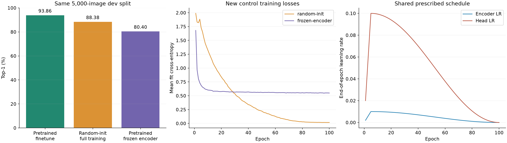

# DirectCLR on ImageNet-100

DirectCLR uses a fixed subvector for contrastive learning and the full encoder output for frozen evaluation ([paper](https://arxiv.org/abs/2110.09348)). This is a small-scale ImageNet-100 validation with ResNet-50.

| Experiment | Encoder epochs | Evaluation | Top-1 | Top-5 |
|---|---:|---|---:|---:|
| DirectCLR, 256 dimensions, temperature 0.2 | 400 | Frozen classifier, final validation (5,000 images) | **79.80%** | **94.98%** |
| Earlier matched DirectCLR control | 100 | Frozen classifier, final validation | 62.26% | — |
| Earlier matched linear-projector control | 100 | Frozen classifier, final validation | 64.42% | — |

The 100-epoch control favors the linear projector by 2.16 points. The 400-epoch result has no matched 400-epoch projector control.

## Training and selection

The subspace width **256 was fixed before these experiments**. API defaults 360/0.1 follow the reference implementation; temperature and the 200/400-epoch choice below use the training development split, not final validation.

| Temperature | Encoder epochs | Final dev Top-1 |
|---:|---:|---:|
| 0.05 | 200 | 73.64% |
| 0.1 | 200 | 77.73% |
| 0.2 | 200 | 79.12% |
| 0.2 | 400, fresh full schedule | 81.81% |

The fixed stratified split uses seed 2026 (114,020 fit / 12,669 dev rows). Encoder seed is 0, global batch 512, LARS peak LR 1.2, weight decay 1e-6, 10-epoch warmup then cosine. The 400-epoch run starts from a new encoder with 98,800 updates; it does not extend a completed 200-epoch cosine schedule. Source images are pre-resized to 160 px, with actual SSL/evaluation crops at 224 px. Temperature runs include a hardware migration and distributed ordering changes.


Each frozen classifier trains for 100 epochs on L2-normalized full-width features. Classifier LR is chosen using dev (15/30/60 in the selection work); the chosen recipe uses LR 60, batch 1024 and a new full-train classifier before one final validation evaluation: 3,990/5,000 Top-1 and 4,749/5,000 Top-5. Historical fit uses augmented images with the encoder and BN frozen. The supplied cache-based evaluator uses center-crop features and is a distinct readout recipe.


## Fixed-encoder subspace and spectrum diagnostic

The pre-CIFAR SSL encoder and center-view cache stay fixed. First256, last256,
fixed random orthogonal Q256 and full2048 each receive the same fit/dev rows,
seed 0, zero-initialized head, LR 15/30/60 grid and 100 epochs / 11,200 updates.
The learning rate is selected using final-epoch dev only.

| Readout | Head parameters | Dev Top-1 | Effective rank / dimension |
|---|---:|---:|---:|
| First256 | 25,700 | 70.94% | 43.55% |
| Last256 | 25,700 | 75.07% | 84.99% |
| Fixed Q256 | 25,700 | 77.13% | 80.12% |
| Full2048 | 204,900 | 81.19% | 47.43% |


The first three heads have equal trainable capacity; full2048 has more
parameters. Q is a fixed posthoc readout, not a projector added to SSL training.
All spectra use the same 4,096 fit-only rows, L2-normalized features and
FP64-centered covariance; effective rank uses entropy of data singular values.
Last256 has a more uniform spectrum than Q256 but lower accuracy, so spectral
uniformity alone does not explain readout performance. One encoder/projection
seed and reused dev limit interpretation. These center-cache results use a
different readout protocol from the main frozen evaluation above.

The preserved diagnostic figure and the four-row
[summary CSV](results/directclr/data/subspace-readout-summary.csv) report
previously recorded measurements. The CSV contains summary metrics, not the
full spectral curve arrays. This is supplementary analysis; reproducing the
four spectra requires feature extraction and their stated preprocessing.

## Separate supervised transfer

The selected SSL encoder was also fine-tuned on CIFAR-10 with a new 10-class head: 45,000/5,000 train/dev split (seed 2026), input 160, seed 0, 100 epochs / 17,600 updates, SGD encoder/head LR 0.01/0.1, momentum 0.9, weight decay 5e-4, five-epoch warmup then cosine. Dev is 93.86%; one final test is 93.57% (9,357/10,000). Recovery retains the first 45 epochs and the original remaining schedule. This supervised transfer score is separate from ImageNet frozen evaluation.


### Fixed-budget CIFAR development controls

Two new controls use the same 45,000/5,000 training/dev split, seed 0,
head initialization, row order, input 160 and 100-epoch / 17,600-update
schedule as the historical pretrained fine-tuning recipe. Fixed-epoch
evaluation gives 88.38% (4419/5000) for random-init full supervised
training and 80.40% (4020/5000) for a frozen pretrained encoder/BN with
head-only training. Historical pretrained full fine-tuning is 93.86%
(4693/5000) on this same dev split, 5.48 and 13.46 percentage points higher.
Each control retains the fixed recipe rather than receiving separate tuning.
No new CIFAR test or ImageNet final validation is evaluated.



The curves show all 100 epoch mean losses and the prescribed schedule;
each control records five bounded same-batch AMP retries with no skipped
successful updates. These single-seed results support transfer under this
recipe; they do not determine each control's best achievable accuracy.
The 400-epoch SSL projector control remains unavailable.

## Fresh-run commands

Install the library with `python -m pip install .`. Prepare the pinned data before allocating training hardware, then run the selected SSL configuration:

```bash
python benchmarks/imagenet100/directclr.py prepare --data-dir /data/imagenet100 --data-revision 0519dc2f402a3a18c6e57f7913db059215eee25b
python benchmarks/imagenet100/directclr.py train --data-dir /data/imagenet100 --data-revision 0519dc2f402a3a18c6e57f7913db059215eee25b --method directclr --backbone resnet50 --dim 256 --temperature 0.2 --epochs 400 --batch-size 512 --lr 0.6 --augmentation reference --precision 16-mixed --devices 4 --seed 0 --output /data/runs/imagenet100-r50-400ep-directclr-seed0
```

The CLI LR is scaled by global batch / 256, giving peak 1.2. Obtain the actual checkpoint path from the run's `training_summary.json`. On one visible evaluation GPU, these commands prepare cached features without scoring final validation, select classifier LR on dev, and only then refit on all training rows and score final validation:

```bash
CHECKPOINT=$(python -c 'import json; print(json.load(open("/data/runs/imagenet100-r50-400ep-directclr-seed0/training_summary.json"))["checkpoint"])')
python benchmarks/imagenet100/directclr.py evaluate --data-dir /data/imagenet100 --data-revision 0519dc2f402a3a18c6e57f7913db059215eee25b --backbone resnet50 --checkpoint "$CHECKPOINT" --cache-only --output /data/runs/imagenet100-r50-400ep-directclr-seed0/evaluation
python benchmarks/imagenet100/probe_sweep.py prepare-split --source /data/runs --encoder-epochs 400 --split /data/runs/dev-split.pt --output /data/runs/readouts
python benchmarks/imagenet100/probe_sweep.py sweep --source /data/runs --encoder-epochs 400 --split /data/runs/dev-split.pt --output /data/runs/readouts --learning-rates 15 30 60 --epochs 100 --batch-size 1024 --seed 0
```

`probe_sweep.py` is retained for dev selection and refit; the cache-based commands are separate from the historical augmented-fit classifier described above. Regenerate the three figures with `python benchmarks/imagenet100/results/directclr/plot_training.py`; the five small CSV inputs preserve logged values without smoothing. Model weights and feature tensors are generated by fresh runs rather than included here.

## Interpretation limits

One encoder seed and the missing matched 400-epoch baseline limit conclusions about method superiority. The early matched comparison is a negative result. Repeated dev exploration, earlier val/test exposure and unlabeled dev images in SSL pretraining limit independence; reduced source resolution, AMP/DDP and recovery boundaries also affect comparisons. This validation uses ImageNet-100 rather than the paper's ImageNet-1K protocol.
