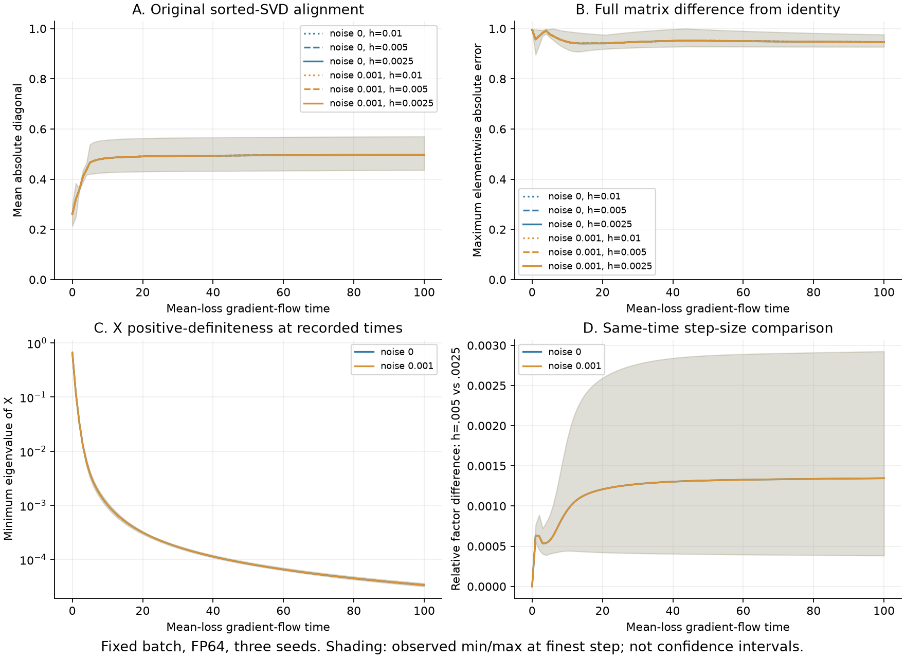
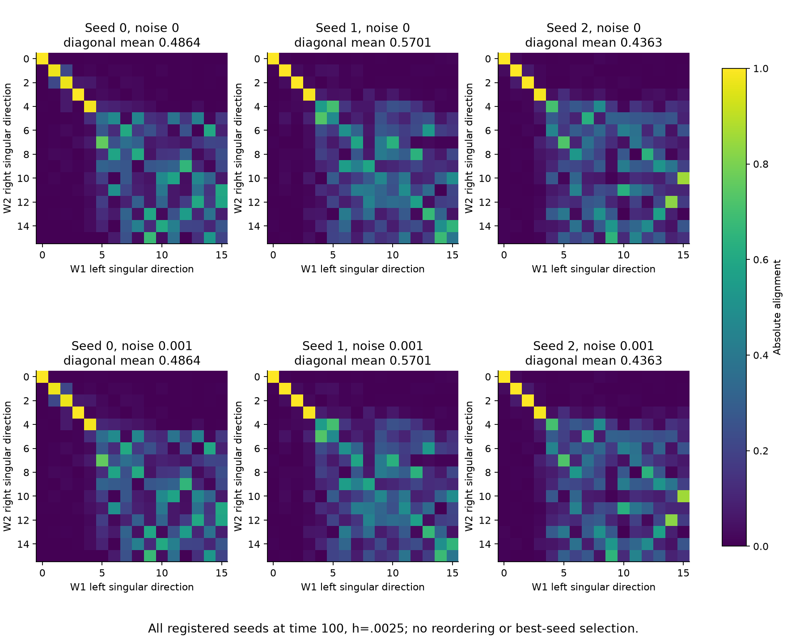

# DirectCLR: finite-time layer alignment under paper Equation 2

This separate CPU experiment implements the unnormalized **distance-form
Equation 2** from [Jing et al., ICLR 2022](https://arxiv.org/html/2110.09348v3).
For anchor i, the denominator contains same-view negatives j != i and the
paired positive. It uses the mean over anchors, with temperature 1. The
[earlier released-code experiment](../directclr/README.md) instead uses
cross-view dot products at temperature 0.1; its results remain unchanged.

## Fixed protocol

All 18 runs were specified before execution: seeds 0/1/2, noise standard
deviations 0 and 0.001, and Euler steps 0.01/0.005/0.0025. The common mean-loss
flow horizon is 100, requiring 10,000/20,000/40,000 updates per respective
step size. Observations occur at integer times including zero.

Each seed uses a fixed batch of 128 independent 16-dimensional Gaussian
anchors and fixed additive Gaussian positive-view perturbations. The same
inputs, perturbations and initialization are shared across step sizes.
This deterministic full-batch setting permits a same-time step-size check;
it differs from stochastic training on the earlier 10,000-example dataset.
Training and diagnostics use CPU FP64 with one numerical-library thread.
The two bias-free factors start at independent orientations with singular
values exp(-0.35 * arange(16)); their singular vectors are not forced to align.
There is no momentum, weight decay or alignment penalty.

The implementation forms X as the weighted pair-difference covariance minus
the weighted augmentation covariance, divided by batch size. The effective
map gradient is -W @ X. Factor gradients follow the chain rule, and both
factors update simultaneously. An independent dense objective and automatic
differentiation verify the matrix expression and gradients.

## Results at the fixed final time

The table uses the finest registered step, 0.0025. The primary alignment
measure is the original sorted-SVD mean diagonal of abs(V2.T @ U1), with
no permutation matching. The three seed values are retained separately.

| Noise standard deviation | Seed 0 | Seed 1 | Seed 2 | Mean |
|---:|---:|---:|---:|---:|
| 0 | 0.4864 | 0.5701 | 0.4363 | 0.4976 |
| 0.001 | 0.4864 | 0.5701 | 0.4363 | 0.4976 |

The mean starts near 0.2612. **Near-identity alignment is not reproduced**:
none of the six finest-step endpoints meets the predeclared requirement of
mean diagonal at least 0.99 and maximum elementwise error at most 0.05.
That numerical tolerance denotes near identity, not mathematical perfection.



- X is positive definite at all 1,818 recorded states, using minimum eigenvalue
  greater than 1e-12 times max(1, spectral norm). At the six finest-step
  endpoints, its minimum eigenvalue is between 3.18e-5 and 3.63e-5.
- Effective maps are nonzero at all recorded states. At the finest-step
  endpoints, minimum adjacent relative factor singular-value gaps are
  6.23%–11.12%; these are finite-time observations, not limiting spectra.
- Comparing steps 0.005 and 0.0025 at matching times, the largest relative
  difference of both factors is 0.002926, and the largest absolute difference
  of diagonal alignment means is 0.001253. Both satisfy the fixed 0.01
  step-convergence tolerances.
- The gradient-flow Gram difference W1 W1.T - W2.T W2 is not enforced by
  projection. Its finest-step relative numerical drift is at most 0.001245
  at the final time. The finite Euler error is measured rather than hidden.



All six matrices are shown in fixed seed order. Shading in the curves shows
the observed three-seed range, not confidence intervals. The no-noise and
weak-noise trajectories nearly overlap, as do the registered step sizes.

## Interpretation

These checks support the correctness and finite-step stability of this
implementation. Removing the objective mismatch and reducing the step size
are insufficient to obtain near identity within the declared horizon.
Theorem 2 concerns an asymptotic limit and assumes conditions for all times,
including distinctive limiting singular values. Finite recorded positive
matrices and finite-time spectral gaps do not establish those assumptions.
The outcome is neither a theorem proof nor a counterexample to the full
asymptotic statement. No result-dependent time extension or seed selection
is used, and no new ResNet accuracy or causal explanation follows from it.

## Reproduction

From the installed checkout, with NumPy, threadpoolctl and Matplotlib:

```bash
python benchmarks/toy/directclr_eq2_alignment.py --output /tmp/directclr-eq2-new
python benchmarks/toy/plot_directclr_eq2_alignment.py --data-dir /tmp/directclr-eq2-new --output /tmp/directclr-eq2-new/figures
python -m pytest -q stable_pretraining/tests/unit/test_directclr_eq2_alignment.py
```

The output directory must be new. The runner stores factor histories as a
compressed numerical JSON for independent recomputation; these synthetic
histories are regenerated by the command rather than committed as large
attachments. The included CSV retains every scheduled scalar observation.
No GPU, real-image encoder training or held-out image evaluation is involved.
