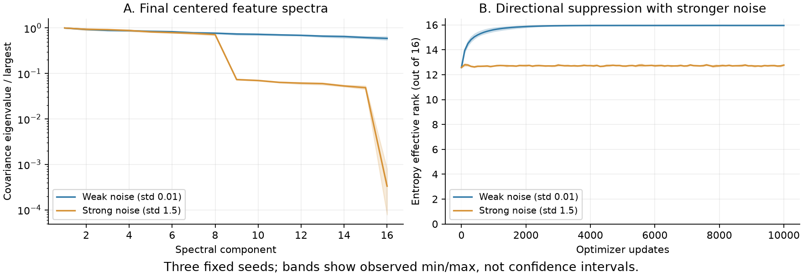
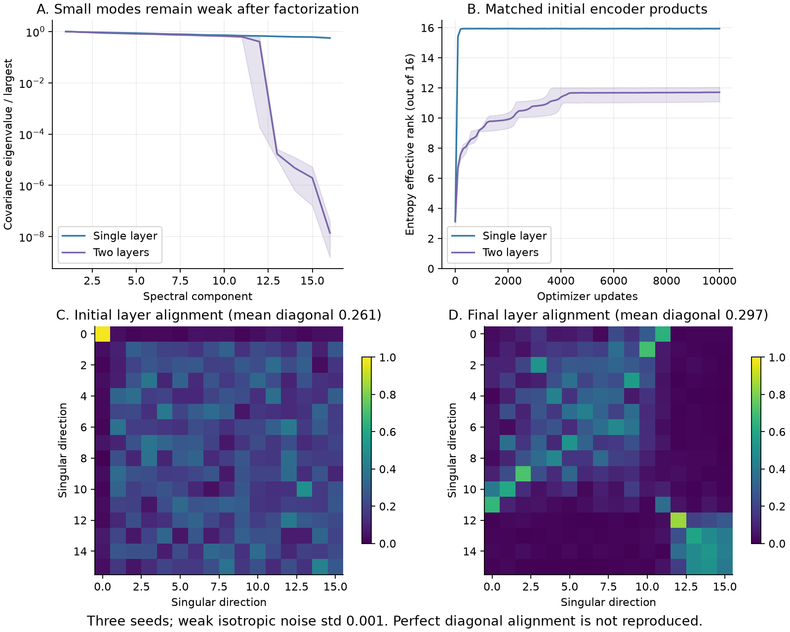
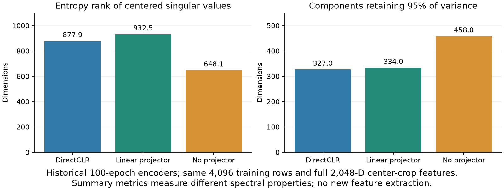

# DirectCLR: controlled CPU mechanism experiments

These experiments examine finite-time behavior suggested by Sections 4 and 5
of [Jing et al., ICLR 2022](https://arxiv.org/html/2110.09348v3). They use
synthetic Gaussian inputs and small linear models. They do not train a new
image encoder or evaluate ImageNet/CIFAR validation or test data.

## Protocol

Each of 12 runs uses 10,000 successful SGD updates, batch 128, 10,000 fixed
16-dimensional Gaussian training points and a separate fixed 1,000-point
diagnostic probe. Seeds are 0, 1 and 2; all declared seeds are reported.
Training uses CPU FP32, with FP64 spectral measurements every 100 updates.
SGD has no momentum or weight decay. Inputs, minibatches and noise draws are
shared within each seed's paired conditions; diagnostic calculations do not
consume the training RNG streams.

The objective is the released authors' toy-code recipe: unnormalized
cross-view dot products, temperature 0.1, and one-way InfoNCE. The theoretical
Equation 2 in the paper instead uses a distance-form objective and its own
negative construction. These runs target the released numerical recipe,
not an exact numerical integration of every analytical theorem. The
[official toy examples](https://github.com/facebookresearch/directclr/tree/main/toy_task)
provide the reference settings; the CPU implementation here is independent.

## Strong augmentation

A single affine 16-to-16 layer receives independent Gaussian noise only in
input coordinates 8 through 15. Noise standard deviations are 0.01 and 1.5;
the learning rate is 0.001. The affine bias follows the released example.
Noise standard deviation, rather than covariance, is the parameter here.

| Final metric, mean over three seeds | Weak noise | Strong noise |
|---|---:|---:|
| Entropy effective rank, maximum 16 | 15.96 | 12.77 |
| Bottom eight covariance modes: energy fraction | 43.74% | 5.93% |
| Smallest/largest feature singular value | 0.768 | 0.0160 |
| Weight energy in noisy / unaffected input columns | 0.991 | 0.0620 |



All three seeds show suppression of the perturbed directions. This is
finite-time spectral concentration: small singular values remain nonzero.
The lower effective rank relative to weak noise is not a claim of exact
algebraic rank loss or of a monotonic decrease from initialization.

## Implicit regularization

The second comparison uses weak isotropic noise with standard deviation
0.001 and learning rate 0.01. The two-layer model has no biases. Each factor
starts with distinct singular values `exp(-0.35 * arange(16))`. The single-layer
control starts at the same product `W2 @ W1`, up to FP32 multiplication
rounding, so both conditions start with the same effective encoder map.
This paired control and the fixed diagnostic probe extend the released setup.

| Final metric, mean over three seeds | Single layer | Two layers |
|---|---:|---:|
| Entropy effective rank | 15.94 | 11.71 |
| Smallest/largest feature singular value | 0.749 | 0.0000921 |



The factorized model retains much weaker small modes in every seed, consistent
with finite-time anisotropic growth under this parameterization. Its effective
rank grows from initialization; it grows less than the single-layer control,
rather than monotonically decreasing throughout training.

Perfect layer alignment is **not** reproduced: the mean absolute diagonal of
`V2.T @ U1` rises from 0.261 to 0.297, with final values 0.238–0.362 across
seeds. Both endpoint alignment matrices are shown. This finite-budget result
does not establish the paper's asymptotic identity-alignment statement.

## Recorded real-encoder spectrum summaries

The original three 100-epoch ResNet-50 encoders used the same 4,096 training
indices (sampling seed 0), full 2,048-dimensional center-crop features and
centering before spectral analysis. These recorded summaries are reused
without new feature extraction. They use raw encoder features; the later
L2-normalized fixed-encoder subspace diagnostic has a different preprocessing
protocol.

| Encoder | Centered entropy effective rank | Components for 95% variance |
|---|---:|---:|
| DirectCLR | 877.90 | 327 |
| Linear projector | 932.51 | 334 |
| Full-dimensional, no projector | 648.13 | 458 |



Entropy rank uses normalized data singular values; variance uses their squares.
The measures need not give the same ordering. This is a summary comparison,
not a reconstruction of the original per-component spectrum arrays. A lower
entropy rank alone does not identify why one classifier achieves lower accuracy.

## Reproduction

From an installed checkout:

```bash
OMP_NUM_THREADS=1 MKL_NUM_THREADS=1 python benchmarks/toy/directclr_mechanisms.py --output /tmp/directclr-mechanisms-run
python benchmarks/toy/plot_directclr_mechanisms.py --data-dir /tmp/directclr-mechanisms-run --output /tmp/directclr-mechanisms-figures
python -m pytest -q stable_pretraining/tests/unit/test_directclr_mechanisms.py
```

The output directory must be new. `--pilot` performs a labeled 100-update
timing check and is not a scientific result. Plot bands show the observed
three-seed minimum/maximum, not confidence intervals. CSV inputs retain every
scheduled scalar observation and every seed; no successful condition is
selected after viewing the outcomes. The historical summary plot reads the
separately included `historical-spectrum-summary.csv`.

These controlled toy results supplement the image experiments. They do not
prove the analytical theorems, determine the cause of the ResNet accuracy
ordering, or resolve the remaining difference from the paper's method ranking.

## Separate distance-objective follow-up

The [Equation 2 alignment experiment](../directclr-eq2/README.md) checks the
paper's distance objective, observed X positivity and three Euler step sizes
under a fixed deterministic batch. Its finite-time near-identity outcome is
also negative. That separate protocol does not replace the released-code
results above or establish the asymptotic theorem.
