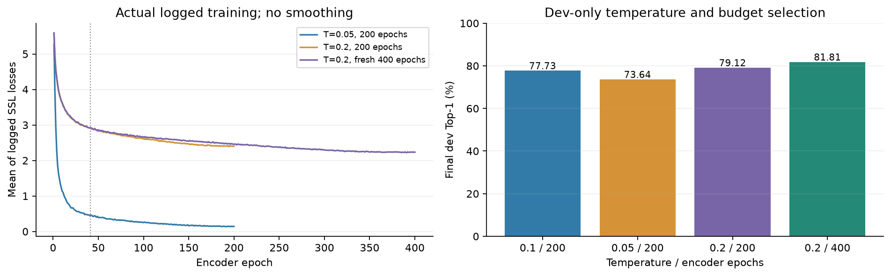
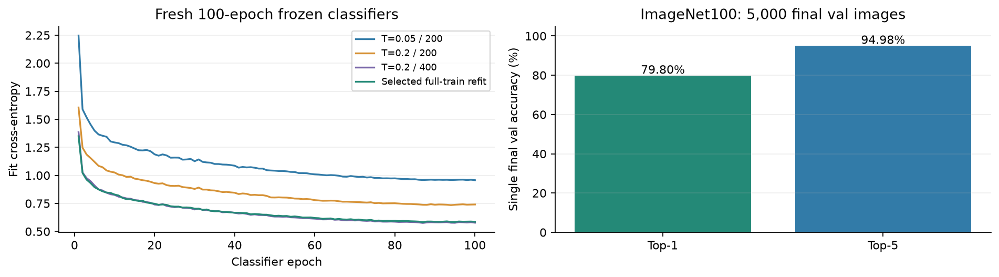
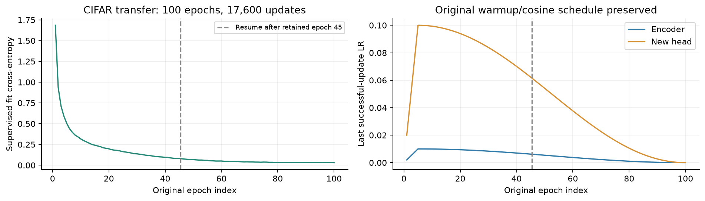
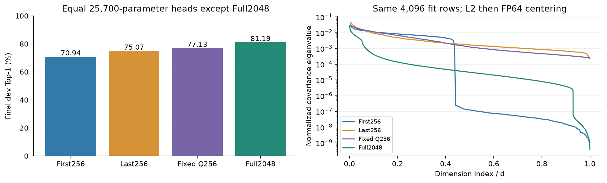

# DirectCLR: training, evaluation and representation analysis

This report separates the method implementation from its course-scale experiments. All scores below were exported only after independent CPU audits and successful job-release checks. The figures are newly formatted from existing numeric records; no training or held-out evaluation was repeated for this submission.

## Method and reference

DirectCLR applies a normalized contrastive objective to a fixed leading subvector of the encoder output and keeps the complete representation for downstream evaluation. The implementation follows the mathematical design in [Jing et al., ICLR 2022](https://arxiv.org/abs/2110.09348), Section6.2; the feature-reading diagnostic is motivated by AppendixF. The source uses symmetric opposite-view InfoNCE, separate backbone forwards for the two views, and autograd-aware distributed candidates. Labels do not enter the SSL objective.

The paper's AppendixD uses ResNet-50,100 ImageNet epochs, batch 4096 across 32 GPUs, LARS LR 4.8 and 10 warmup epochs. Our smaller ImageNet-100 validation uses a different dataset and budget. The method class defaults are an API starting point, not the paper's complete recipe. We do not directly compare our accuracy with the paper's ImageNet-1K accuracy or claim a win over nonlinear SimCLR.

### Why the loss uses a prefix but evaluation uses the full vector

The fixed prefix implements a low-rank coordinate selection without learning a
projector. The loss has zero direct derivative with respect to the omitted
output coordinates. This does not make all upstream channel derivatives zero:
convolutions mix channels, and residual paths can carry shared hidden features
to the full output. This is the paper's ResNet explanation, not a guarantee for
arbitrary backbones. Full-width readout preserves the representation the method
was designed to evaluate. Our tail/Q probes measure accessible information;
they do not independently establish this causal explanation. See
[Section 6.2 and Figure 10](https://arxiv.org/html/2110.09348#S6.SS2)
and the [reference prefix operation](https://github.com/facebookresearch/directclr/blob/main/directclr/main.py).

The current `d0=256` is a recorded experiment choice, not an established optimum.
The Q transform was applied after training; it is distinct from training a new
encoder with a fixed projector, which is the paper's Appendix F ablation.

## ImageNet-100 protocol

| Setting | Measured experiment |
|---|---|
| Dataset | `clane9/imagenet-100`, revision `0519dc2f402a3a18c6e57f7913db059215eee25b` |
| Sizes | 126,689 training images;114,020 fit/12,669 dev;5,000 final val |
| Source and transforms | Source images pre-resized to 160 px; actual SSL/cache crop 224; reference asymmetric SSL views |
| Encoder | ResNet-50 from scratch,2048-dimensional output, fixed first 256 loss coordinates |
| Seed and precision | Seed 0,16-mixed, SyncBN during multi-GPU SSL |
| Global batch | 512; opposite-view negatives gathered across devices |
| Optimizer | LARS, actual peak LR 1.2 (CLI base 0.6), weight decay 1 e-6 |
| Schedule | 10-epoch/2,470-update warmup, then cosine;200 epochs/49,400 updates or fresh 400 epochs/98,800 updates |
| Frozen evaluation | FP32, frozen encoder and BN buffers, forward microbatch 128; new 100-epoch classifiers |
| Selection | Fixed final-epoch dev scores; final val is not used for temperature/budget selection |

The temperature 0.1/200 baseline was retained from the audited earlier run. Two 200-epoch candidates use temperature 0.05 and 0.2; the former preserves a 10,128-update A 6000 prefix before migration to L 40. The two candidates then train on two L 40 s each. The dev-selected temperature receives a **new full 400-epoch encoder run** on four L 40 s. A completed 200-epoch cosine schedule is not extended.

### Training traces and dev selection

| Encoder | Final dev correct/total | Dev Top-1 | Dev Top-5 |
|---|---:|---:|---:|
| Temperature 0.1,200 epochs | 9848/12669 | 77.73% | 94.29% |
| Temperature 0.05,200 epochs | 9330/12669 | 73.64% | 92.67% |
| Temperature 0.2,200 epochs | 10024/12669 | 79.12% | 94.68% |
| Temperature 0.2, fresh 400 epochs | 10364/12669 | 81.81% | 95.24% |

Loss means aggregate finite values logged approximately every 10 updates; they are not full-minibatch epoch averages. The dotted boundary marks the 0.05 migration after 10,128 updates. Different temperatures change InfoNCE scale, so lower SSL loss is not an accuracy ranking:0.05 has the smallest logged loss but the weakest dev result here. The fresh 400-epoch 0.2 run exceeds its 200-epoch counterpart by 2.68 percentage points on this dev. With one seed, repeated dev exploration and hardware/order changes, this is an observation rather than a statistically significant isolated budget effect.

### Frozen classifier and one final validation

The fixed LR 60 classifier trains 100 epochs for each encoder on fit rows. The strict dev winner is then evaluated through a freshly initialized classifier trained on all 126,689 training images for 100 epochs. The encoder and its BN buffers stay frozen. This final refit is separate from SSL and from the dev classifier.

The single final validation gives **3990/5000 Top-1=79.80%** and **4749/5000 Top-5=94.98%**. There is no fabricated per-epoch val/dev accuracy curve: the retained histories contain training losses and fixed final scores. Earlier validation exposure and repeated dev use remain disclosed.

The earlier matched 100-epoch comparison gave DirectCLR 62.26% and a single linear-projector control 64.42%, a difference of -2.16 percentage points. This experiment did not reproduce the paper's performance advantage over a linear projector. It remains a valid negative result and is not by itself evidence of an implementation error. The later 400-epoch 79.80% result validates that separate training/evaluation recipe; it cannot establish a method advantage against the 100-epoch control. A new matched 400-epoch baseline was cancelled before GPU allocation because its queue prediction fell after the deadline; it has no result. Additional encoder seeds were not admitted within the complete time margin.

## CIFAR-10 supervised transfer and recovery

The selected pre-CIFAR SSL encoder initializes supervised CIFAR training with a new 10-class head and a trainable encoder. This is **supervised transfer**, not CIFAR SSL or frozen linear evaluation. Official 50,000 training images are stratified into 45,000 fit/5,000 dev with split seed 2026; the official 10,000 test images are excluded from selection.

| Setting | Fixed transfer protocol |
|---|---|
| Input | Original 7×7, stride 2 stem; CIFAR random crop/flip, resize 160, ImageNet normalization |
| Training | Seed 0, batch 256, no drop-last;176 updates/epoch,100 epochs,17,600 successful updates |
| Optimizer | SGD momentum 0.9, weight decay 0.0005; encoder/head peak LR 0.01/0.1 |
| Schedule and precision | 880-update warmup, original 100-epoch cosine; FP 16 AMP training, FP32 evaluation |
| Evaluation | Fixed epoch 100; dev first, checkpoint seal, then one test; no best-epoch or test tuning |

The original L 40 allocation stops on non-finite gradients during epoch 46. Recovery retains the complete epoch 45/7,920-successful-update checkpoint, including model, BN, SGD momentum, AMP scaler and Python/NumPy/CPU/CUDA RNG states. The failed partial epoch 46 is discarded. L 40 S resumes epochs 46–100, preserving the remaining 9,680 updates and original schedule. Non-finite gradients trigger bounded same-batch AMP retries after BN/RNG rollback; batches are not skipped and failed attempts are not successful updates. Five retries occurred at epochs 46,57,69,80 and 92. This does not establish hardware failure or cross-device bitwise equivalence.

The separate CPU audit verifies the old 45-epoch prefix, row orders,55 resumed epochs, finite states and all 17,600 updates. Final dev is 4693/5000=93.86%; the **one final test is 9357/10000=93.57%**, Top-5=99.86%. No random-initialization or frozen-encoder CIFAR control was run, so the transfer gain attributable to pretraining is not estimated.

## Frozen readout and paired spectra

All diagnostics below use the unchanged pre-CIFAR 400-epoch SSL encoder. The same center-view cache, fit/dev split, seed 0, zero initialization,100 epochs/11,200 updates, and LR 15/30/60 grids are used for each arm. Each arm selects LR on its fixed final-epoch dev result. Old coordinate/full-head runs are reused by exact hashes; only the three Q heads are new.

| Readout | Head parameters | Selected LR | Dev correct/total | Top-1 |
|---|---:|---:|---:|---:|
| First256 | 25,700 | 60 | 8988/12669 | 70.94% |
| Last256 | 25,700 | 15 | 9510/12669 | 75.07% |
| Fixed orthogonal Q256 | 25,700 | 15 | 9772/12669 | 77.13% |
| Full2048 | 204,900 | 60 | 10286/12669 | 81.19% |

Q is generated once from seed 0 FP64 Gaussian 2048×256, reduced QR with positiveR diagonal, then castFP32 and frozen. Projection uses canonical blockwise FP64 multiplication, FP32 conversion and rowL2 normalization. Q is not chosen using labels/dev and is **posthoc**, never inserted into the SSL method.

Four spectra use identical 4,096 fit-only sampled rows, headL2 preprocessing, FP64 centering and covarianceXᵀX/N. Independent directSVD verifies all four. Effective-rank/d, defined with entropy of data singular values sqrt(N×lambda), is 43.55%/84.99%/80.12%/47.43% for first/last/Q/full. All four have full numerical rank at preregistered thresholds;95% variance dimensions are 100/187/154/430.

Q exceeds the equal-capacity first/last heads by 6.19/2.07 points and trails full by 4.06 points. Equal parameters remove one head-capacity difference, not all feature-transform differences. Last256 is spectrally more uniform thanQ but classifies worse; spectrum uniformity is not a monotonic accuracy proxy. The 81.81% original dev result and 81.19% cached-center readout use different classifier/preprocessing protocols and should not be interpreted as a performance regression. Single encoder/projection seeds do not establish unique causality or significance.

## Validation, cost and reproducibility

Separate historical CPU audits recompute final counts and verify checkpoint/cache/split identities. CIFAR recovery has 188 preflight CPU regressions; coordinate probes 30, projection/spectra 47. These are separate from the fresh submission-source test results recorded in `VALIDATION.md`; pass counts are not combined into a misleading whole-project result.

Actual Slurm whole-allocation GPU seconds are 443,656 for the four-L 40 parent,13,232 for the old A 6000 allocation,104 and 2,168 for health/migration diagnostics, and 2,748 for the complete CIFAR task including its failed L 40 allocation. CPU-only coordinate/projection diagnostics cost 3,144/816 core-seconds with 0 GPU seconds. Step time is not added again to parent allocation cost. Older Round 7/8 costs remain separate in the archived evidence. GPU time is allocation cost, not idealized active compute or a prediction of reproduction speed.

The candidate source omits the separate historical Slurm-step handoff framework fix and archival-only tooling; exact executed sources and full raw audits remain in immutable prior deliveries. Candidate smoke tests validate the focused code, not bitwise reproduction of historical multi-allocation runs. `data/` records all plotted scalars/eigenvalues, exact source digests and a derived score summary. No tensors or credentials are included. Run `python benchmarks/imagenet100/results/directclr/plot_training.py` to regenerate these figures.

Reproduction entry points and fresh-run commands are documented in the DirectCLR guide. Source images 160 px/crop 224, cached-center versus augmented evaluation, single seeds, repeated dev, earlier val/test exposure, unlabeledSSL dev-image participation, mixed precision, DDP sample ordering/SyncBN and recovery boundaries all limit comparison. No additional model tuning is required to understand the claims made here.
